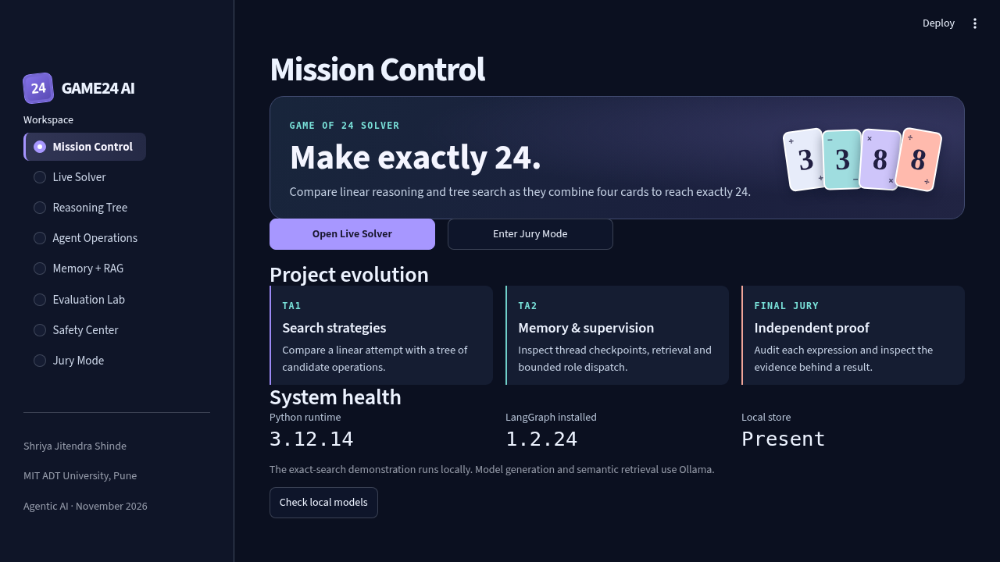

# GAME24 AI

**Game of 24 Solver: Chain-of-Thought vs Tree-of-Thought**  
Explainable, Memory-Augmented Multi-Agent Reasoning System  
Shriya Jitendra Shinde · MIT ADT University, Pune · Agentic AI · November 2026



Give the solver four cards from 1 to 13. Compare a single linear attempt, a beam search and a supervised multi-agent workflow. Inspect the arithmetic, branch decisions, tool calls and retrieval records behind each result. The final proof certificate independently checks that the expression consumes the original multiset and equals 24 exactly.

## Start on Windows

Install 64-bit Python 3.12 with the Python launcher, extract the ZIP into a new folder, open Command Prompt there and run:

```bat
run_final.bat
```

The launcher creates a local `.venv`, installs the pinned runtime on first launch, and starts Streamlit. Initial setup needs internet. Open the local URL printed in the terminal (usually http://localhost:8501). For the quickest jury segment choose **Jury Mode → Run fractional demonstration**. It runs explicit deterministic search live and exports its trace. Choose **Live Solver → Local Qwen** for model generation.

## Enable the model and retrieval

Install [Ollama](https://ollama.com/download/windows) and start its local service. In the extracted project folder:

```bat
ollama pull qwen2.5:3b
ollama pull nomic-embed-text
.venv\Scripts\python -m final_jury.prepare_data --data-dir data/runtime --receipt data/rebuild-01.json
```

The receipt records actual SQLite schemas, row counts and reopened Chroma collections. Choose a new receipt filename when repeating. The dashboard automatically seeds its verified-example index when that option is first used. For the historical TA2 dashboard, seed its own corpus with `.venv\Scripts\python -m ta2.cli ingest`. A fresh store contains no personal sessions. Preserve any existing Windows data directory separately. Only the seed documents and verified teaching examples can be reconstructed from source.

## Navigate the demonstration

| Section | What to inspect |
|---|---|
| Mission Control | Project stages and runtime health |
| Live Solver | Four presets or custom cards, three methods, explicit engine selection and export |
| Reasoning Tree | A selected operation, intermediate values, parent branch and pruning reason |
| Agent Operations | Supervisor dispatch, hops, tool actions, generation metrics and proof status |
| Memory + RAG | Checkpointed history, SQLite records, retrieved examples and matched k=0/1/3 trials |
| Evaluation Lab | Recorded case outcomes, assistance, costs, provenance and CSV download |
| Safety Center | Independent expression audit and ten isolated failure demonstrations |
| Jury Mode | Guided five-minute presentation, live solve and labeled replay |

## Commands from the project root

On Windows after running the launcher, use `.venv\Scripts\python` in place of `python` below. On Linux or macOS with Python 3.12 use `python3.12 scripts/launch.py` to install and start the dashboard, or install `requirements.txt` into an existing environment.

```bash
python scripts/audit_ta1.py ta1
python -m unittest discover -s tests -v
python -m unittest discover -s tests_ta2 -v
python -m final_jury.check_integrations --output data/integration-01
python -m benchmarks.run --mode reference --output data/reference-01
python -m benchmarks.run --mode ollama --rag-k 0 1 3 --output data/qwen-01
python -m streamlit run app.py
python -m streamlit run app_ta2.py
python -m streamlit run ta2/prototype/app_ta2.py
```

Use a fresh output directory for each evidence run. The original root TA1 and TA2 apps retain their historical behavior. When running TA1 in isolation, the entire pinned application is also available under `ta1/`. The 68-line earlier TA2 UI remains available alongside the expanded jury-branch UI. The final project uses modules beyond that assessment client.

## Read the evidence

- [Editable final jury presentation](presentations/GAME24_AI_Final_Jury.pptx)
- [Five-minute walkthrough](docs/DEMO.md) and [individual viva guide](docs/JURY_VIVA.md)
- [Final implementation and technical report](CODEX_IMPLEMENTATION_REPORT.md)
- [Architecture](docs/ARCHITECTURE.md) and [source recovery / CRLF checks](docs/SOURCE_RECOVERY.md)
- [Evaluation conditions and results](docs/EVALUATION.md) and [historical Windows raw evidence](results/ta2-acceptance-ad0424cd/)
- [Safety report](docs/SAFETY.md), [integration and database rebuild report](docs/INTEGRATION.md) and [test evidence](traces/tests/)
- [Fractional run](traces/fractional-exact.json) and [fresh real-model integration](traces/live-integration/)
