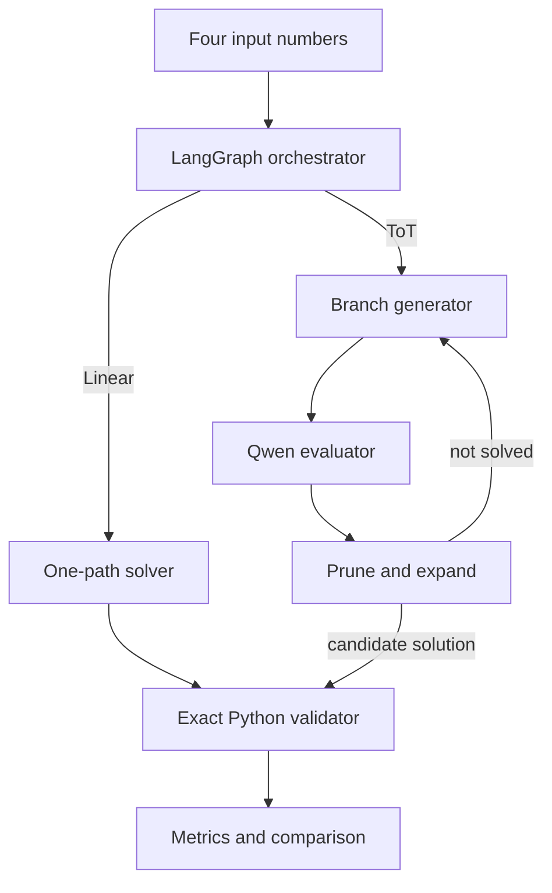

# Agentic Game of 24 Solver

**Chain-of-Thought-style linear reasoning vs Tree-of-Thought agentic search using Python, LangGraph, Ollama, and Qwen2.5:3b.**

## Research question

Can an agent that generates, evaluates, prunes, and expands multiple arithmetic paths solve deceptive Game-of-24 instances more reliably than a single sequential attempt—and what additional latency and token cost does that search introduce?

The project is deliberately a controlled experiment. It never lets the LLM grade itself: every proposed expression is checked by a safe Python AST validator using exact `Fraction` arithmetic.

## What is implemented

- Linear one-trajectory baseline with a fixed prompt
- Tree-of-Thought branch → evaluate → prune → expand loop
- LangGraph conditional routing (with a dependency-free fallback)
- Local Qwen2.5:3b calls through Ollama
- Exact independent expression validator
- Exhaustive ground-truth solver
- Streamlit live demo and benchmark dashboard
- Latency, token, step, node, and validity metrics
- CSV export and unit tests
- Three difficulty-controlled puzzles: `[4,7,8,8]`, `[1,5,5,5]`, `[3,3,8,8]`

## Architecture



## Quick start on Windows

1. Install Python 3.10+ and [Ollama](https://ollama.com/).
2. Open Command Prompt in this folder.

```bat
python -m venv .venv
.venv\Scripts\activate
pip install -r requirements.txt
ollama pull qwen2.5:3b
```

Keep Ollama running, then launch:

```bat
streamlit run app.py
```

If `ollama serve` is required on your system, run it in a separate terminal.

## Run the experiment

One seed gives the assignment's six executions:

```bat
python run_experiment.py --runs 1
```

Five fixed seeds produce 30 executions:

```bat
python run_experiment.py --runs 5
```

For a working offline demo without Ollama:

```bat
python run_experiment.py --no-ollama --output results/deterministic_baseline.csv
```

The script clearly labels fallback rows as `deterministic_fallback`. Do not present them as Qwen measurements.

## Reproducible settings

| Setting | Value |
|---|---|
| Model | `qwen2.5:3b` |
| Temperature | `0` |
| Seeds | `42` to `46` for five-run experiment |
| Response mode | non-streaming |
| Arithmetic | exact rational numbers |
| Context | fresh API generation per call |

## Fairness note

The linear method receives one sequential attempt and no explicit branching instruction. ToT may evaluate multiple states and therefore has a larger compute budget. That asymmetry is the phenomenon being measured, so the report includes tokens, latency, nodes, and steps—not success alone.

## Tests

The core tests use only Python's standard library:

```bat
python -m unittest discover -s tests -v
```

## Project structure

```text
game24-agentic-ai/
├── app.py                    # Streamlit UI
├── run_experiment.py         # reproducible benchmark CLI
├── game24/
│   ├── agents.py             # linear and ToT agents
│   ├── engine.py             # legal moves + ground truth
│   ├── experiment.py         # benchmark loop + CSV
│   ├── models.py             # typed result models
│   ├── ollama_client.py      # local LLM API
│   ├── prompts.py            # controlled prompts
│   ├── validator.py          # safe exact verification
│   └── workflow.py           # LangGraph controller
├── tests/
├── docs/
├── results/
└── requirements.txt
```

## Scientific conclusion rule

Do not claim that CoT failed where ToT succeeded unless the saved Qwen CSV actually shows it. If both solve all puzzles, conclude that ToT made search explicit and auditable but consumed extra inference. This is a stronger, truthful result.

