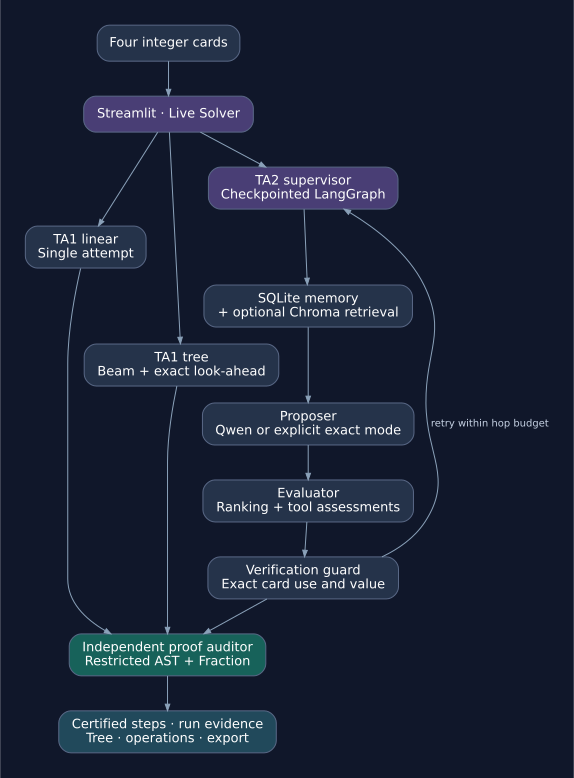

# Execution and evidence

## The four-card state

Each term carries a rational value and its expression. A legal move consumes two terms and introduces one term. After three moves a complete path must contain exactly one term. Subtraction and division consider both operand orders. A zero divisor removes that move. Equal remaining multisets have identical arithmetic continuations under the four allowed operations.

## The three methods

- **TA1 linear** receives one prompt and one expression attempt when Qwen is selected. The frozen deterministic baseline takes a greedy path. A failed attempt leaves solvability open.
- **TA1 ToT** enumerates legal moves, preselects up to three first moves using exact look-ahead, evaluates candidates and retains two branches. In model mode a missing or unparseable ranking for an individual candidate can receive an exact fallback score. This design makes the original method oracle-assisted even with a functioning model.
- **TA2** uses a checkpointed LangGraph state machine. The proposer and evaluator use separate prompts and invoke the same Qwen weights in model mode. The supervisor routes work within a hop budget. The verifier checks every submitted expression. Historical hybrid policy can send a failed attempt to a bounded exact search. The final jury graph extends this implementation with failed-branch memory, observable exact search, and structured solved-example retrieval.

## Where an answer acquires authority

The final proof auditor has its own restricted AST visitor. Only integer card leaves and four binary operators reach arithmetic evaluation. It bounds expression length and AST size, checks input multiplicity and computes the exact rational value. The three displayed arithmetic statements come from postorder replay of that AST. A model ranking can propose an answer. The certificate establishes its mathematical status. Full exhaustion of a legal-state search can establish an unsolvable puzzle. Exhausting a hop or node budget only establishes that the run stopped.

## Persistence and reproducibility

SQLite checkpoints retain thread execution state and history. The separate SQLite Store holds namespaced long-term records. TA2 indexes the packaged rule corpus with Chroma and nomic-embed-text. The final dashboard uses a separate collection of structured verified examples. An embedding distance orders the retrieved documents. A logged example in the proposal context proves availability to the model. Causal benefit requires comparing like-for-like runs.

One judge can inspect a live result, download its JSON evidence, then reproduce the proof from the four card leaves. Archived benchmark rows retain their own model, assistance and execution conditions.
